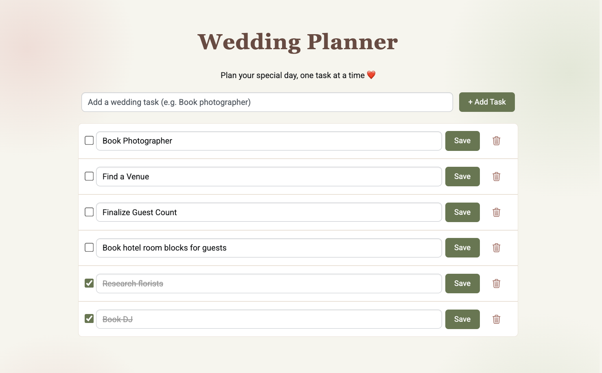

<h1>Wedding Planner Web Application</h1>

A full-stack wedding task management web application built with Java and Spring Boot. Users can create, view, update, complete, and delete tasks through a simple, responsive interface.

## Homepage Screenshot

## Tech Stack
- Backend: Java, Spring Boot, Spring MVC
- Frontend: Thymeleaf, HTML5, CSS3, Bootstrap
- Persistence: Spring Data JPA, Hibernate, JPQL
- Build Tool: Maven

## Features
- Create Tasks: Add new tasks.
- View Tasks: Display all existing tasks.
- Update Tasks: Edit task descriptions.
- Track Completion: Mark tasks as completed using checkboxes.
- Delete Tasks: Remove tasks using a trash icon.

## Architecture
The application follows a layered architecture:
- Controller: Handles HTTP requests.
- Service: Manages business logic.
- Repository: Handles data access.
- Entity: Defines task data and persistence mapping.
- View: Renders dynamic HTML using Thymeleaf.

<h2>Getting Started</h2>

Prerequisites
- Java JDK
- Maven

Run Locally

git clone https://github.com/shan-jiang-dev/TODOApplication.git

cd TODOApplication

mvn spring-boot:run

Open your browser at http://localhost:8080.
	
<h2>Future Enhancements</h2>

- User authentication
- Task priorities and due dates
- Search and filtering
- Automated testing

<h2>Author</h2>

Shan Jiang